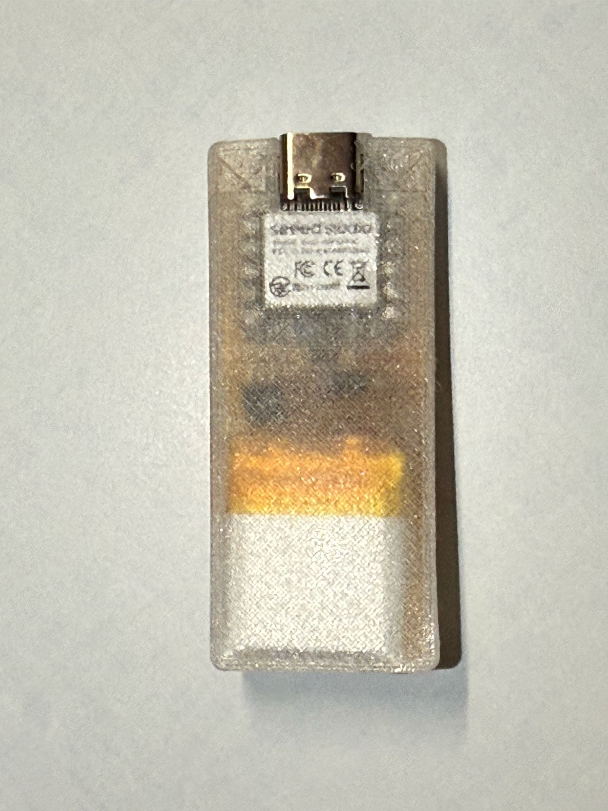
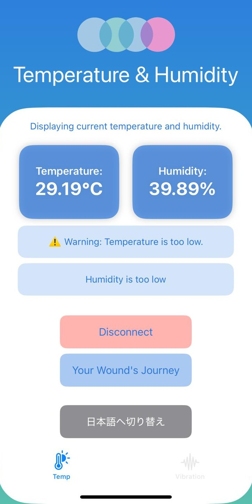
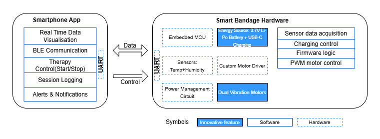
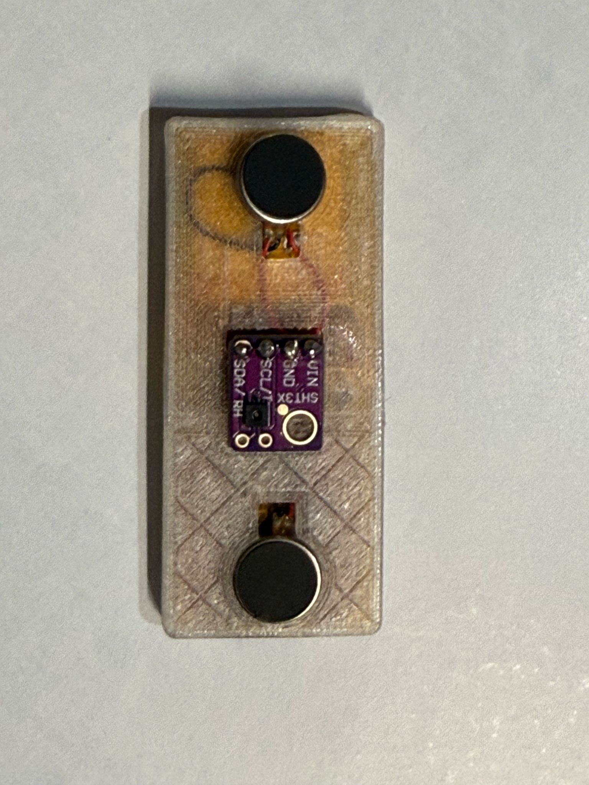
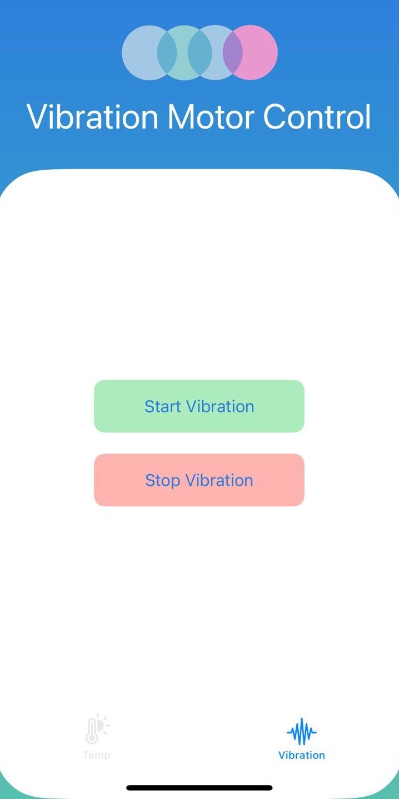
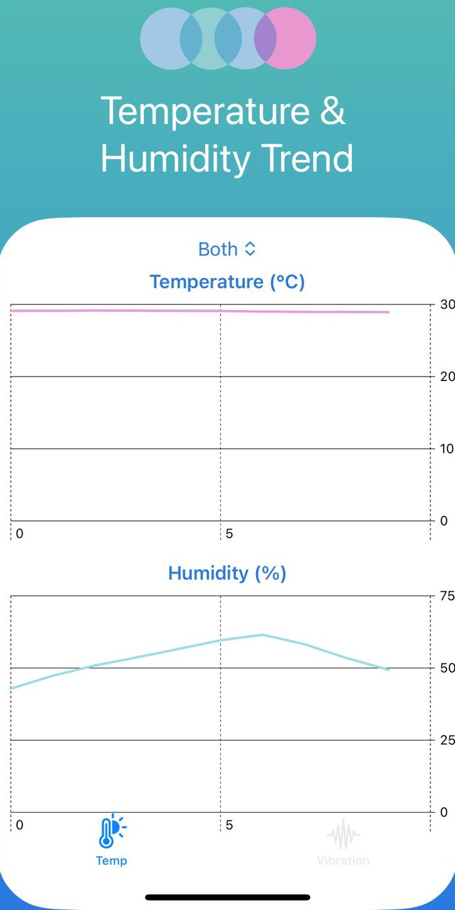

# Smart Bandage: Real-Time Wound Monitoring and Vibration Therapy

A wearable, rechargeable smart bandage that streams wound-site **temperature and humidity** to a phone over **Bluetooth Low Energy** and drives **low-frequency vibration motors** for mechanotherapy. It is built on a **Seeed XIAO nRF52840** (Nordic nRF52840, Arm Cortex-M4F, BLE 5.0).

This project is published as a first-author paper at **IEEE GCCE 2025**: *"From Skin to Screen: Real-Time Wound Monitoring with a Smart Bandage and Smartphone."* (Citation below.)

<p align="center">
  
  
</p>

▶ **[Demo video](docs/media/demo.mp4)**

## System overview



The device has two parts:

- **A reusable electronics module** in a 3D-printed TPU case. It contains the MCU, the sensor, the motor driver and the battery.
- **A disposable adhesive wound-contact patch** that snap-fits to the module, so only the cheap part is thrown away.

| Subsystem | Implementation |
|---|---|
| MCU / radio | Seeed XIAO nRF52840 (BLE 5.0, Bluefruit stack) |
| Sensing | Sensirion SHT31-D over I²C at 0x44 (±0.3 °C, ±2 % RH) |
| Therapy | 2× coin vibration motors (Seeed 316040001), 45–60 Hz |
| Motor driver | Low-side N-MOSFET (SI2300), 1N5817 flyback diode, pull-down resistor |
| Power | 3.7 V 200 mAh Li-Po, USB-C charging |
| App | iOS (Swift): live readings, alerts, history graph, therapy on/off |

## Firmware

The production sketch is [`firmware/smart_bandage/smart_bandage.ino`](firmware/smart_bandage/smart_bandage.ino).

- **BLE UART (Nordic UART Service).** The device advertises as `Smart Bandage` and sends `"<temp>,<humidity>\n"` at **1 Hz**.
- **App commands.** `ON` / `OFF` sent over BLE UART switch the motor PWM (50 Hz, 50 % duty) through the MOSFET on pin D6.
- **Low power.** Between samples the CPU sleeps in `sd_app_evt_wait()` (SoftDevice event wait) instead of busy-looping. Sensor strings use stack buffers rather than `String`, which avoids heap fragmentation.
- **Debug switch.** Setting `#define DEBUG 0` strips all serial logging for production builds.

### Development history (`firmware/archive/`)

| Sketch | Stage | What it tested |
|---|---|---|
| `s1_nfc_sensor_logger` | Stage 1 | XIAO RP2040 + PN532: SHT31 readings written to an NFC tag |
| `s2a_ble_sensor_stream` | Stage 2 | Moved to nRF52840; streams SHT31 data over BLE UART |
| `s2b_motor_test` | Stage 2 | Motor on/off timing test |
| `s2c_ble_pwm_combined` | Stage 2 | BLE streaming and 2 s on/off PWM vibration together |
| `s2d_low_power_auto_cycle` | Stage 2 | Event-driven sleep between sensor reads and motor toggles |
| `s2e_ble_motor_control` | Stage 2 | Motor controlled from the app over BLE |

Stage 1 used NFC, so a phone had to tap the bandage to read it. Switching to BLE made the readings continuous, and that change is what made remote monitoring possible.

### Build

1. Arduino IDE → **Boards Manager** → install **Seeed nRF52 Boards** and select **Seeed XIAO nRF52840**.
2. Install the libraries **Adafruit SHT31** and **nRF52_PWM** (khoih-prog).
3. Open `firmware/smart_bandage/smart_bandage.ino` and upload it.
4. Connect with any BLE UART app (for example nRF Connect or Bluefruit Connect). Send `ON\n` or `OFF\n` and watch the CSV readings arrive.

## Hardware

The KiCad 9 project is in [`hardware/kicad/`](hardware/kicad/), with the schematic, a 2-layer PCB and custom symbols and footprints for the XIAO nRF52840, the SHT3x, the motors, the N-FET and the battery.

<p align="center">
  
</p>

## Results (bench tests, no human subjects)

- Sensor readings stayed within physiological wound-care ranges (20–40 °C, 40–90 % RH) under controlled heat and humidity sources.
- BLE UART streaming at 1 Hz had **latency under 200 ms** and stayed stable within **5 m** indoors.
- Motors actuated from the app responded in **under 1 s**.
- The device ran untethered on its 200 mAh battery.

<p align="center">
  
  
</p>

## Paper

> F. M. Hossain, D. J. G. Tan, I. M. Ameer, Q. Q. Ayun, S. Matsunaga, S. A. Junaideen, and Z. Liang, "From Skin to Screen: Real-Time Wound Monitoring with a Smart Bandage and Smartphone," in *Proc. IEEE Global Conference on Consumer Electronics (GCCE)*, 2025. DOI: _add DOI_

```bibtex
@inproceedings{hossain2025skin,
  title     = {From Skin to Screen: Real-Time Wound Monitoring with a Smart Bandage and Smartphone},
  author    = {Hossain, Faizan M. and Tan, Daphne Jillian Gan and Ameer, Imad Mohamed and Ayun, Queena Qurrota and Matsunaga, Suo and Junaideen, Suleiman Arif and Liang, Zilu},
  booktitle = {Proc. IEEE Global Conference on Consumer Electronics (GCCE)},
  year      = {2025},
  doi       = {ADD-DOI}
}
```

The accepted manuscript is available on my [portfolio site](https://YOUR-PORTFOLIO-URL).

## Team

Developed at the **Ubiquitous and Personal Computing Lab, Kyoto University of Advanced Science**. Co-authors: Daphne Jillian Gan Tan, Imad Mohamed Ameer, Queena Qurrota Ayun, Suo Matsunaga, Suleiman Arif Junaideen and Zilu Liang.

**Faizan Hossain** (first author) · [LinkedIn](https://www.linkedin.com/in/faizan-hossain/)
